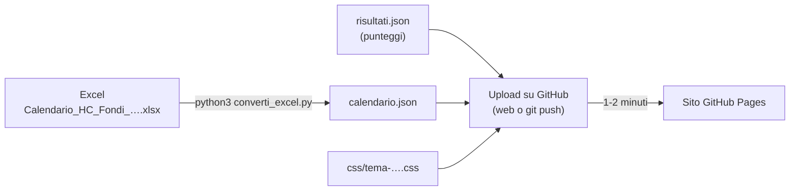
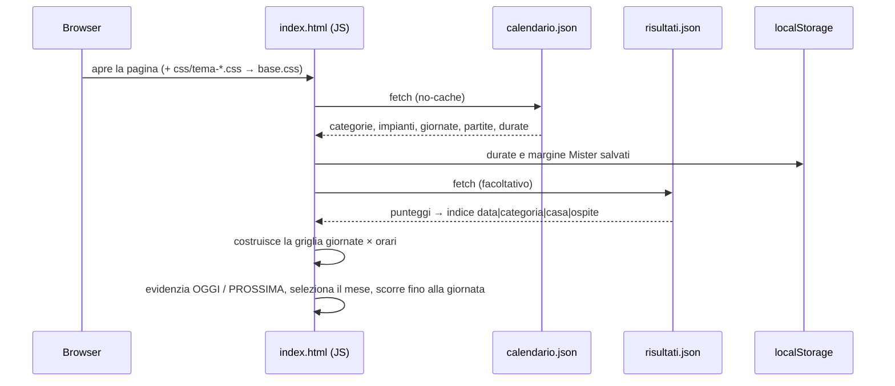

# HC Fondi Campionati 26-27

Tabellone web della stagione 2026/2027 dell'**HC Fondi**: Serie B, U18 F, U16 F, U16 M,
Under 14, gare interne ed eventi (Selezione Talenti, finali), dal 03/11/2026 al 30/06/2027.

Indirizzo: **<https://sharkencode80.github.io/HC_Fondi_26_27/>**

Il sito ha due versioni e sceglie da solo quella adatta al dispositivo:

| Pagina | Per | Indirizzo |
|---|---|---|
| `index.html` | computer e tablet: tabellone giornate × orari | `…/HC_Fondi_26_27/` |
| `mobile.html` | cellulare: agenda per giornata + dettagli al tocco | `…/HC_Fondi_26_27/mobile.html` |

---

## Indice

1. [Pubblicare su GitHub Pages](#1-pubblicare-su-github-pages)
2. [Aggiornare il sito](#2-aggiornare-il-sito)
3. [Guida per l'utente](#3-guida-per-lutente)
4. [Funzionamento tecnico](#4-funzionamento-tecnico)

---

## 1. Pubblicare su GitHub Pages

GitHub Pages pubblica gratis i file di un repository come sito web. Il sito non ha bisogno
di un server: bastano le due pagine HTML, le cartelle `css/` e `js/` e i file JSON.
Con il piano gratuito il limite è **un sito per repository**, non una pagina: un sito
può contenere tutte le pagine che servono.

### File da pubblicare

| File | Necessario | Note |
|---|:-:|---|
| `index.html` | ✅ | versione completa (tabellone) |
| `mobile.html` | ✅ | versione cellulare |
| `css/` (tutta la cartella) | ✅ | stile, temi e layout mobile |
| `js/vista.js` | ✅ | scelta automatica della versione |
| `calendario.json` | ✅ | il calendario |
| `risultati.json` | ✅ | i punteggi (anche vuoto) |
| `README.md`, `.gitignore` | consigliato | queste istruzioni e l'elenco dei file da escludere |
| `converti_excel.py` | consigliato | serve per rigenerare il calendario |
| `Calendario_…xlsx` | facoltativo | ⚠️ in un repository **pubblico** chiunque può scaricarlo |
| `~$Calendario_…xlsx`, `.DS_Store` | ❌ | file temporanei, già esclusi da `.gitignore` |

> GitHub Pages è gratuito solo con i repository **pubblici**: tutti i file caricati
> diventano visibili a chiunque.

### Metodo A — dal sito github.com (senza terminale)

1. Vai su <https://github.com/new>.
   - **Repository name:** `HC_Fondi_26_27`
   - **Public**
   - non aggiungere README, `.gitignore` o licenza (ci sono già nella cartella)
   - **Create repository**
2. Nella pagina del repository vuoto clicca **uploading an existing file**.
3. Trascina nella pagina **`index.html`, `calendario.json`, `risultati.json`, `README.md`,
   `converti_excel.py` e la cartella `css`**. Trascina la cartella intera, così GitHub
   mantiene il percorso `css/…`.
   I file che iniziano con il punto (`.gitignore`) sono nascosti nel Finder: si
   vedono con `Cmd + Shift + .`.
4. In fondo scrivi un messaggio (es. "Prima pubblicazione") e clicca **Commit changes**.
5. Vai in **Settings → Pages**:
   - **Source:** *Deploy from a branch*
   - **Branch:** `main`, cartella `/ (root)` → **Save**
6. Dopo 1-2 minuti il sito è online su
   `https://sharkencode80.github.io/HC_Fondi_26_27/`. L'indirizzo compare anche in cima
   alla pagina *Settings → Pages*.

### Metodo B — dal terminale (git + GitHub CLI)

Da eseguire nella cartella del progetto. L'account GitHub deve essere già collegato
(`gh auth login`).

```bash
cd ~/IdeaProjects/HC_Fondi_26_27

git init -b main
git add index.html mobile.html css js calendario.json risultati.json converti_excel.py README.md .gitignore
# facoltativo: git add "Calendario_HC_Fondi_2026_2027_completo 30 10 2026 verificato.xlsx"
git commit -m "Prima pubblicazione HC Fondi Campionati 26-27"

# crea il repository pubblico su GitHub e carica i file
gh repo create HC_Fondi_26_27 --public --source=. --push

# attiva GitHub Pages sul branch main (cartella principale)
gh api -X POST repos/SharkenCode80/HC_Fondi_26_27/pages \
  -f "source[branch]=main" -f "source[path]=/"
```

Controllo dello stato della pubblicazione:

```bash
gh api repos/SharkenCode80/HC_Fondi_26_27/pages --jq '.status, .html_url'
```

Lo stato passa da `building` a `built` in un paio di minuti.

### Se qualcosa non va

| Problema | Causa probabile | Soluzione |
|---|---|---|
| Errore 404 | Pages non ancora attivo o ancora in costruzione | controlla *Settings → Pages*, attendi 2 minuti |
| Pagina senza grafica | manca la cartella `css/` o i file sono finiti fuori dalla cartella | nel repository deve esistere `css/tema-….css` |
| "Impossibile caricare calendario.json" | file mancante o nome diverso | `calendario.json` deve stare accanto a `index.html` |
| Modifiche non visibili | cache del browser | ricarica forzata (`Cmd + Shift + R`) o attendi 1-2 minuti |

---

## 2. Aggiornare il sito



### Calendario (dall'Excel)

1. Modifica e **salva** l'Excel. Il file deve restare nella cartella del progetto.
2. Rigenera il JSON:
   ```bash
   cd ~/IdeaProjects/HC_Fondi_26_27
   pip3 install openpyxl          # solo la prima volta
   python3 converti_excel.py      # usa l'ultimo .xlsx della cartella
   # oppure: python3 converti_excel.py "nome file.xlsx"
   ```
   Lo script stampa quante voci ha letto e segnala con `[attenzione]` i giorni della
   settimana sbagliati e le celle con categoria non riconosciuta.
3. Pubblica il nuovo `calendario.json`:
   - **web:** nel repository *Add file → Upload files*, trascina `calendario.json` → *Commit*;
   - **terminale:**
     ```bash
     git add calendario.json && git commit -m "Aggiorna calendario" && git push
     ```

### Risultati

Aggiungi i punteggi in `risultati.json`, con lo stesso formato del Festival della Pallamano:

```json
{
  "updated": "08/11/2026 14:00",
  "source": "inserimento manuale",
  "results": [
    { "date": "03/11", "cat": "u16f", "home": "HC Fondi", "away": "PDO Handball Salerno U16F",
      "hs": 25, "as": 19, "status": "FINE" }
  ]
}
```

`date`, `cat`, `home` e `away` devono corrispondere alla partita in `calendario.json`
(maiuscole e spazi non contano; se casa e ospite sono invertiti, il punteggio viene
girato in automatico). In alternativa si può usare `generatore.html` del progetto
Festival della Pallamano (sezione *Risultati extra*).

### Calendari da abbonamento (.ics) — in anteprima

`genera_ics.py` crea, da `calendario.json` e `risultati.json`, i calendari a cui ci si
può abbonare dal telefono (si aggiornano da soli quando cambia il file sul sito):

| File | Contenuto |
|---|---|
| `calendario.ics` | tutte le partite ed eventi |
| `calendario-<categoria>.ics` | una categoria (`serieb`, `u18f`, `u16f`, `u16m`, `u14`, `sel`); le gare interne sono sia in U18 F sia in U16 F |
| `calendari.json` | elenco dei calendari, letto da `abbonati.html` |

```bash
python3 genera_ics.py      # nessuna libreria esterna
```

`converti_excel.py` lo lancia già da solo alla fine. **Se modifichi `calendario.json` o
`risultati.json` a mano (anche da GitHub), rilancia `genera_ics.py` e pubblica anche i
`.ics`**, altrimenti i calendari degli abbonati restano indietro.

Le pagine con il pulsante **📅 Abbonati** sono per ora un'anteprima, raggiungibile solo
con link diretto (e con `noindex`): `anteprima.html`, `anteprima-mobile.html` e
`abbonati.html`. Quando vanno bene, si sostituiscono a `index.html` / `mobile.html`.

### Cambiare tema

Il tema si imposta nella riga `<link … id="tema">`, **in entrambe le pagine**
(riga 16 di `index.html` e di `mobile.html`). Mettere lo stesso tema in tutte e due:

```html
<link rel="stylesheet" href="css/tema-rossoblu.css" id="tema">
```

In `mobile.html`, subito dopo, resta sempre `<link rel="stylesheet" href="css/mobile.css">`.

| Tema | File |
|---|---|
| Rossoblù (colori HC Fondi) — **attivo** | `css/tema-rossoblu.css` |
| Classico (come il Festival) | `css/tema-classico.css` |
| Scuro | `css/tema-scuro.css` |
| Arancio | `css/tema-arancio.css` |
| Minimal (anche per la stampa) | `css/tema-minimal.css` |
| Compatto (smartphone) | `css/tema-compatto.css` |

---

## 3. Guida per l'utente

### Come si legge il tabellone

- **Colonne:** le giornate con almeno una partita o un evento (giorno della settimana e data).
- **Righe:** gli orari di inizio. La prima riga, **Evento**, contiene le voci senza orario
  (Selezione dei Talenti, raduni Under 14, finali).
- **Card:** in ogni card trovi:
  - la categoria (etichetta colorata);
  - **CASA** o **TRASFERTA**;
  - le due squadre, con HC Fondi evidenziato;
  - l'impianto;
  - il punteggio, se è già disponibile.
- **Partite in casa:** sono evidenziate con lo sfondo colorato.
- **Giornata in evidenza:** quella di oggi (**OGGI**) o la prossima in calendario
  (**PROSSIMA**) ha il bordo giallo. Le partite in corso in questo momento hanno il badge
  **in corso**.

### Filtri

| Pulsante | Cosa fa |
|---|---|
| **Serie B, U18 F, U16 F, …** | mostra/nasconde una categoria (spento = trasparente) |
| **Tutta la stagione / Novembre 26 / …** | mostra un solo mese o l'intera stagione. All'apertura è selezionato il mese della prossima giornata |
| **📋 Mister** | attiva la modalità Mister (sotto). **Ora nascosto**: vedi la nota sotto |

Righe e colonne rimaste vuote dopo i filtri vengono nascoste in automatico.

### Modalità Mister

> Al momento il pulsante è **nascosto** dalla regola `.chip.mister-btn{display:none}` in
> `css/base.css`. Per riattivarlo basta cancellare quella riga: il resto è tutto al suo posto.

È pensata per chi segue più squadre nello stesso giorno. Per ogni partita calcola l'ora
di fine (inizio + durata stimata della categoria). Se tra due gare dello stesso giorno
non c'è abbastanza **margine**, le segna in rosso con **⚠ possibile accavallamento**.

- Le durate (in minuti) e il margine si possono cambiare nel pannello che compare in alto.
- I valori scelti restano salvati nel browser di quel dispositivo.
- Valori iniziali: Serie B, U18 F e gare interne 70′; U16 60′; Under 14 50′;
  margine 30′, che comprende gli spostamenti.

### Versione cellulare (`mobile.html`)

- **Lista per giornata** che scorre in verticale. Ogni card mostra orario, categoria,
  Casa/Trasferta, avversario e città; se c'è il punteggio, anche il risultato con
  **Vinta / Persa / Pareggio**.
- **Filtri** in alto, che scorrono in orizzontale: mese (o "Tutto") e categorie.
- Le giornate passate sono attenuate; la prossima ha il badge **Prossima** (o **Oggi**) e
  la pagina si apre già posizionata lì. Il pulsante **↓ Prossima** in basso a destra ci
  riporta in qualsiasi momento.
- **Toccando una partita** si apre un pannello con data completa, squadre, punteggio,
  orario con fine indicativa e impianto, più due pulsanti: **Mappa** (Google Maps) e
  **Aggiungi al calendario** (scarica un file `.ics`).

### Quale versione si apre

Si apre la versione cellulare sugli schermi larghi **fino a 700 px** (telefoni in
verticale), quella completa altrimenti. I pulsanti **📱 Versione cellulare** e
**🖥 Versione completa** permettono di cambiare a mano: la scelta vale finché la scheda
resta aperta. Entrambe le pagine si ricaricano da sole ogni 10 minuti.

---

## 4. Funzionamento tecnico

### Struttura

```
HC_Fondi_26_27/
├── index.html            versione completa: HTML + JavaScript, nessuno stile interno
├── mobile.html           versione cellulare (agenda + pannello dettagli)
├── calendario.json       dati del calendario (generato dall'Excel)
├── risultati.json        punteggi (facoltativo)
├── converti_excel.py     Excel → calendario.json (+ lancia genera_ics.py)
├── genera_ics.py         calendario.json → calendario*.ics + calendari.json
├── css/
│   ├── base.css          struttura + variabili (colori, font, dimensioni)
│   ├── tema-*.css        ogni tema importa base.css e ridefinisce le variabili
│   └── mobile.css        layout agenda di mobile.html (usa le variabili del tema)
├── js/
│   └── vista.js          sceglie index.html o mobile.html in base allo schermo
├── README.md
└── .gitignore
```

### Dall'Excel al JSON (`converti_excel.py`)

Il foglio contiene 8 blocchi mese da 3 colonne (`GIORNO | G | PARTITA HC FONDI`). Le
giornate con due voci occupano due righe con le celle del giorno unite. Lo script:

1. trova i blocchi mese leggendo le intestazioni (`NOVEMBRE 2026`, …);
2. per ogni riga ricava il giorno, anche dalle celle unite, e controlla il giorno della
   settimana;
3. legge la cella partita, divisa in tre righe:
   `CATEGORIA – HH:MM – CASA|TRASFERTA` / `vs AVVERSARIO` / `Impianto - Città`;
4. con **CASA** mette HC Fondi come `home`, con **TRASFERTA** come `away`;
5. riconosce le gare interne (`U18F/U16F … vs HC Fondi U16F`): la squadra di casa è la
   categoria dell'intestazione che **non** compare nell'avversario (`HC Fondi U18F`);
6. le celle senza orario diventano **eventi** (`"event": true`, `time: ""`);
7. assegna un codice a ogni impianto e scrive `calendario.json`.

La categoria si ricava **dal testo** della cella, non dal colore: nel file i colori non
sono usati in modo uniforme.

| Codice | Etichetta | Riconosciuto da |
|---|---|---|
| `serieb` | Serie B | `SERIE B` |
| `u18f` | U18 F | `U18…`, `Finali U18` |
| `u16f` | U16 F | `U16F`, `Finali U16` |
| `u16m` | U16 M | `U16M` |
| `u14` | Under 14 | `UNDER 14`, `U14` |
| `interna` | Gara interna | intestazione con `/` (es. `U18F/U16F`) |
| `sel` | Selezione Talenti | `Selezione dei Talenti` e testi non riconosciuti |

### Formato di `calendario.json`

È lo stesso formato del Festival della Pallamano, quindi compatibile con il suo
`generatore.html`:

```json
{
  "event": { "title": "HC Fondi Campionati 26-27", "eyebrow": "…", "subtitle": "…",
             "source": "nome file Excel", "updated": "31/10/2026 09:54" },
  "fondiTeam": "HC Fondi",
  "year": 2026, "start": "03/11/2026", "end": "30/06/2027",
  "days": ["03/11", "05/11", "…"],
  "dow":  { "03/11": "MAR", "…": "…" },
  "categories": { "serieb": "Serie B", "u18f": "U18 F", "…": "…" },
  "venues": { "fondi-palasport-fondi": "Fondi Palasport - Fondi", "…": "…" },
  "mister": { "buffer": 30, "durate": { "serieb": { "tempo": 30, "pausa": 10 }, "…": {} } },
  "matches": [
    { "date": "03/11", "time": "18.00", "cat": "u16f", "gir": "Casa",
      "home": "HC Fondi", "away": "PDO Handball Salerno U16F",
      "venue": "fondi-palasport-fondi", "year": 2026 },
    { "date": "29/11", "time": "", "cat": "sel", "gir": "Evento",
      "home": "Selezione dei Talenti", "away": "", "venue": "", "event": true, "year": 2026 }
  ]
}
```

Rispetto al Festival ci sono queste differenze:
- `gir` contiene *Casa*, *Trasferta* o *Evento* invece del girone;
- `year` per ogni partita, perché la stagione è a cavallo di due anni;
- `event` per le voci senza orario.

### Come lavora la pagina



- **Filtri:** le card, le righe e le colonne vengono nascoste aggiungendo la classe
  `hidden`. Il JavaScript non scrive stili, tutto l'aspetto è nei CSS.
- **Accavallamenti (Mister):** due gare A e B dello stesso giorno sono in conflitto se
  `A.inizio < B.fine + margine` **e** `B.inizio < A.fine + margine`, con
  `fine = inizio + (2 × tempo + pausa)`.
- **Temi:** `base.css` definisce tutte le variabili in `:root` (es. `--bg`, `--head-bg`,
  `--fondi`, `--serieb`, `--font-display`). Ogni `tema-*.css` fa
  `@import url("base.css")` e ridefinisce solo le variabili o le regole che cambia.
  Per creare un tema nuovo, copia un tema esistente e modificane i valori.
- **Nuova categoria:** oltre a riconoscerla in `converti_excel.py` (funzione `cat_code`),
  aggiungi in `base.css` la variabile `--codice`/`--codice-t` e le regole `.dot.codice` e
  `.m.codice`.
- **Scelta della versione (`js/vista.js`):** caricato nel `<head>` di entrambe le pagine.
  Se la larghezza dello schermo è al massimo `SOGLIA` (700 px) vuole `mobile.html`,
  altrimenti `index.html`; se la pagina aperta è l'altra, fa `location.replace`. I link
  tra le versioni aggiungono `?v=mobile` / `?v=full`, salvato in `sessionStorage` e
  prioritario sulla scelta automatica; `?v=auto` lo annulla.
- **Credito:** la scritta in alto a destra viene inserita da uno script in fondo a
  `index.html`. Il testo è codificato in Base64 e lo script lo ripristina se qualcuno lo
  rimuove. L'aspetto è definito dalla regola `#credit` in `css/base.css`.

### Provare in locale

Aperta con doppio clic (`file://`), la pagina non può leggere i JSON. Serve un piccolo
server:

```bash
cd ~/IdeaProjects/HC_Fondi_26_27
python3 -m http.server 8000
# poi apri http://localhost:8000
```
